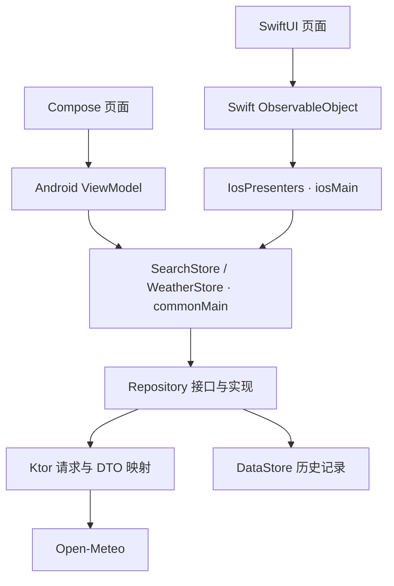

# leon的KMP天气应用

基于 Kotlin Multiplatform 的 Android / iOS 天气应用，由 WeatherApp 迁移而来。数据与业务逻辑放在 shared，Android 使用 Jetpack Compose，iOS 使用 SwiftUI。天气与地点搜索由 Open-Meteo 提供，无需 API Key。

## 功能

- 中英文城市搜索、常用城市快捷入口。
- 最近五个城市的本地历史记录，支持单条删除和一键清空。
- 当前天气、高低温、体感温度、湿度、风速和紫外线指数。
- 未来 24 小时与七天预报，按城市当地时间展示。
- 手动刷新、回前台自动更新；刷新失败保留上次数据，支持重试。

## 运行

构建需要 JDK 17 或更高版本；Android 需要 SDK 36 和 Build Tools 36.0.0；iOS 需要 macOS、Xcode 及模拟器 runtime。

**Android（8.0 / API 26 及以上）**：使用 Android Studio 打开项目根目录，配置 SDK，完成 Gradle 同步后运行 `androidApp`。

```bash
./gradlew :androidApp:assembleDebug
```

APK 输出至 `androidApp/build/outputs/apk/debug/androidApp-debug.apk`。

**iOS（16 及以上）**：打开 `iosApp/WeatherApp.xcodeproj`，选择 `WeatherAppKMP` Scheme 和模拟器运行。Xcode 会自动构建 shared framework；真机运行需配置开发团队签名。

## 架构

工程分为 `shared`、`androidApp` 和 `iosApp`。shared 负责网络、本地存储、数据转换和业务状态；两端保留各自的 UI、导航和生命周期适配。

### 目录结构

```text
shared/src/
├── commonMain/kotlin/com/leon/weather/
│   ├── model/                  城市、天气快照、天气类型与常用城市
│   ├── data/
│   │   ├── remote/             API 接口、DTO、Ktor 请求与 JSON 配置
│   │   ├── mapper/             DTO 校验、天气代码与时间转换
│   │   └── repository/         仓库接口及实现、历史记录、统一错误分类
│   ├── presentation/
│   │   ├── SearchStore.kt      搜索防抖、取消旧请求、搜索状态与历史操作
│   │   ├── WeatherStore.kt     天气加载、刷新合并、过期与跨日判断
│   │   └── NativePresentation.kt  面向 Swift 的展示数据与状态转换
│   ├── time/                   可注入时钟、时区与日期/数值格式化
│   └── WeatherEnvironment.kt   组装 HTTP Client、DataStore 与 Repository
├── androidMain/kotlin/com/leon/weather/
│   ├── AndroidEnvironment.kt   Android 沙盒中的历史文件路径
│   └── data/remote/HttpEngine.kt  Ktor OkHttp 引擎
├── iosMain/kotlin/com/leon/weather/
│   ├── IosEnvironment.kt       iOS 沙盒路径与应用级依赖实例
│   ├── IosPresenters.kt        将共享状态转换为 Swift 可订阅的主线程回调
│   └── data/remote/HttpEngine.kt  Ktor Darwin 引擎
├── jvmMain/                    JVM 回归测试所需的 OkHttp 引擎适配
├── commonTest/                 网络协议、映射、搜索/刷新状态等共享测试
└── jvmTest/                    历史文件持久化与并发写入测试

androidApp/src/
├── main/java/com/leon/weather/
│   ├── WeatherApplication.kt   应用入口与依赖容器持有者
│   ├── MainActivity.kt         Compose 界面入口
│   ├── di/AppContainer.kt      使用 Android Environment 提供共享依赖
│   └── ui/
│       ├── search/             搜索页面与 SearchViewModel
│       ├── weather/            天气页面与 WeatherViewModel
│       ├── navigation/         页面导航、前台事件与返回键处理
│       ├── components/         通用 UI 组件
│       └── theme/              Compose 主题
├── main/res/                   文案、图标与 Android 资源
├── test/                       Android 单元测试
└── androidTest/                Compose 界面流程测试

iosApp/
├── WeatherApp/
│   ├── WeatherApp.swift        SwiftUI 应用入口
│   ├── Models.swift            ObservableObject，订阅 Kotlin Presenter 状态
│   ├── SearchView.swift        搜索页面与导航
│   ├── WeatherView.swift       天气页面与前台事件转发
│   └── Components.swift        天气图标、样式与通用组件
├── WeatherAppUITests/          真实网络界面测试与图标渲染回归
└── WeatherApp.xcodeproj/       Xcode 工程与共享 Scheme

scripts/xcode-build-shared.sh   Xcode 构建阶段调用 Gradle 生成 Shared framework
gradle/libs.versions.toml       统一管理依赖与插件版本
```

### 模块关系与数据流

Android 通过 Gradle 直接依赖 `:shared`；iOS 通过 `import Shared` 使用 Kotlin 编译生成的静态 framework。两个应用模块彼此独立，shared 不依赖 Compose 或 SwiftUI。

下图表示调用方向，处理结果通过状态订阅返回界面：



- **共享业务**：Store 依赖 Repository 接口。网络仓库调用 API，并通过 mapper 将响应转换为领域模型；历史仓库使用 DataStore 保存城市列表。Store 统一管理加载、成功、错误、刷新等状态。
- **Android 状态回传**：ViewModel 将用户操作委托给 Store，并暴露其 `StateFlow`；Compose 使用 `collectAsStateWithLifecycle` 订阅。协程由 `viewModelScope` 管理，查询通过 `SavedStateHandle` 保存。
- **iOS 状态回传**：Presenter 将 Store 状态转换为 `SearchViewData` / `WeatherViewData`，在主线程回调 Swift。`Models.swift` 通过 `@Published` 驱动界面，释放时关闭订阅和 Presenter；页面将回前台事件交给共享刷新逻辑判断。
- **平台边界**：HTTP 引擎使用 `expect/actual` 切换 OkHttp 与 Darwin，存储路径由各平台 Environment 提供。历史保存在各端本地，天气仅保留在内存中；JVM target 用于共享逻辑回归测试。

## 验证

```bash
./gradlew :shared:jvmTest :androidApp:testDebugUnitTest :androidApp:lintDebug
# Apple Silicon Mac，需安装 iOS 模拟器 runtime
./gradlew :shared:iosSimulatorArm64Test
```

iOS 界面测试可在 Xcode 中选择 `WeatherAppKMP` Scheme 后执行 Test，流程测试需要网络连接。

详细记录：[iOS 运行验证](docs/verification/ios-runtime-validation.md) · [图标渲染回归](docs/verification/ios-symbol-visibility.md) · [改造复杂度评估](docs/MIGRATION_ASSESSMENT.md)。

## 数据来源

[Open-Meteo 地点搜索](https://open-meteo.com/en/docs/geocoding-api) · [天气预报](https://open-meteo.com/en/docs)。天气数据遵循 [CC BY 4.0](https://creativecommons.org/licenses/by/4.0/)；应用进行了中文映射、数值舍入、时间转换和预报范围筛选。
